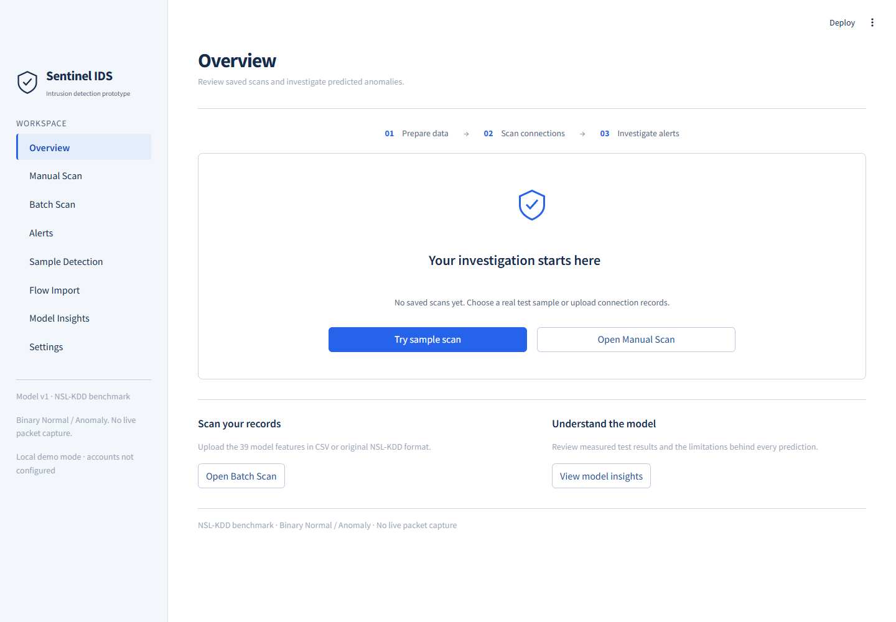

# Sentinel IDS v1.0

[](https://github.com/ShkS44D/Sentinal-AI/actions/workflows/checks.yml)

**A network intrusion detection prototype with connection scanning, persistent
alert investigation, and reproducible benchmark evaluation.** Built with Python,
Streamlit, scikit-learn and SQLite.

Sentinel IDS classifies compatible connection records as **Normal** or
**Anomaly**, saves scans locally, and helps an analyst investigate the results.
The model is trained on NSL-KDD. This is a working research and portfolio
prototype: it does not capture live packets, identify specific attack types,
or block network traffic.



## Features and workflow

**Choose data → Scan connections → Investigate alerts → Export results**

| Page | What it does |
|---|---|
| Overview | Shows saved scan totals, anomaly rate, open alerts, real activity charts and scan shortcuts. |
| Manual Scan | Accepts 39 features, with training-based defaults, explanations and recorded test examples. |
| Batch Scan | Validates CSV or NSL-KDD TXT, scans up to 100,000 rows, and provides filters, threshold controls, CSV and HTML exports. |
| Alerts | Supports search, pagination, status changes, notes, bulk actions, filtered export and model sensitivity exploration. |
| Sample Detection | Predicts one official test example and reveals its recorded label only when requested. |
| Flow Import | Reviews Zeek JSON connection logs, filters protocols and exports CSV; it does not score them. |
| Model Insights | Shows benchmark reliability, threshold comparisons, probability analysis and global feature importance. |
| Settings | Provides local database backups, imports, confirmed deletion and audit records. Administrator-only when accounts are configured. |

**Model Insights** includes a reliability report with errors by recorded attack
family, threshold trade-offs and probability bins. Alert details offer an
optional model sensitivity comparison against training reference values.
**Flow Import** reviews real Zeek JSON connection logs without inventing missing
NSL-KDD features or assigning unsupported scores. **Sample Detection** includes
a guided first scan.

The interface uses a blue-and-white theme with an **Overview**, consistent page
headings and clearly labeled scan steps. Select **Try sample scan** from the
Overview or Batch Scan to process the bundled real test rows in one click;
these scans are tagged as demo activity. Restart Streamlit after updating the
theme configuration.

Optional administrator/analyst accounts, container setup and automated GitHub
checks are documented in [docs/OPERATIONS.md](docs/OPERATIONS.md).

## Measured performance

<!-- METRICS:START -->
Random Forest on **NSL-KDD KDDTest+** (22,544 rows), trained on **KDDTrain+** (125,973 rows):

| Accuracy | Precision | Recall | F1 | False positive rate | ROC-AUC | PR-AUC |
|---:|---:|---:|---:|---:|---:|---:|
| 76.37% | 96.59% | 60.62% | 74.49% | 2.83% | 96.56% | 96.53% |

Training cross-validation F1 is 99.88%, while the official test F1 is 74.49%. Official test recall is 60.62%; the model misses many anomalies in this split.
<!-- METRICS:END -->

These numbers are generated from [reports/metrics.json](reports/metrics.json)
by `python -m src.train`. See [the full report](reports/metrics.md) for the
five-fold training comparison, confusion matrix and evaluation plots.
The official test split has a different distribution and attack types absent
from training; the gap shows that training-fold scores do not represent
performance on the harder official test set.

The legacy 500-row validation CSV overlaps the training split in **all 500
rows**. Its perfect score is not independent validation; see
[reports/notes.md](reports/notes.md).

## Run the app

Use **Python 3.12**, the version used by the automated checks. In PowerShell:

```powershell
git clone https://github.com/ShkS44D/Sentinal-AI.git
cd Sentinal-AI
python -m venv .venv
.venv\Scripts\python.exe -m pip install -r requirements.txt
.venv\Scripts\python.exe scripts/download_data.py
.venv\Scripts\python.exe -m streamlit run app/main.py
```

Open **http://localhost:8501**. The download script obtains the benchmark files
from a documented mirror and verifies their checksums. If downloading is not
possible, follow [docs/DATA.md](docs/DATA.md) to provide the files manually.
The versioned model is already bundled; training is not required to launch.

On macOS/Linux, create the same virtual environment and use
`.venv/bin/python` instead of `.venv\Scripts\python.exe` in these commands.

### First scan

1. Select **Try sample scan** on Overview. It scans the bundled
   [`data/sample_traffic.csv`](data/sample_traffic.csv), using real KDDTest+ rows.
2. Review predictions in Batch Scan, adjust the threshold, and use the filters.
   Sample results and supplied-label metrics are demo activity, not independent
   evidence of model quality.
3. Download the results CSV or HTML summary.
4. Open **Alerts** to review a predicted anomaly, add notes and change its status.
5. Return to **Overview** to see the saved activity. Use **Model Insights** to
   understand the official evaluation and the model's limitations.

For your own compatible file, choose **Upload a file** in Batch Scan. The
downloadable template lists the required columns.

### Upload format

Batch CSVs need the 39 feature columns listed in the downloadable template.
`protocol_type`, `service`, and `flag` may contain raw names or training encoder
integers; the page explains which form it detected. Optional `label_binary` or
`class` columns use 0 for normal and 1 for anomaly. An optional `attack` column
uses NSL-KDD attack names. Uploaded labels enable live precision, recall, and
false-positive counts when the threshold changes. Without labels, the page
shows prediction counts only. Severity bands classify anomaly probability;
their cutoffs are adjustable and separate from the anomaly decision threshold.

## Saved history and investigations

Every Manual Scan and Batch Scan is saved to the local SQLite database at
`data/sentinel.db` (Git ignored). Sample Detection also saves its real NSL-KDD
test example as a clearly tagged demo scan. **Overview** reads only
saved scan data: totals, anomaly rate, open alerts, time series, top services
and protocols, and recent activity. It shows an empty state before the first
scan. Model evaluation remains in the generated reports rather than being
mixed with operational dashboard counts.

The **Alerts** page lists saved anomaly predictions with search, filters,
sorting and pagination. Open an alert to see all feature values, descriptive
feature observations, status history and analyst notes. The observations are
simple rules based on values; they are not explanations of the model's internal
decision. The separate sensitivity view compares individual values with
training reference values; it is not causal proof. Analysts can update several alerts together and export filtered
alerts to CSV. Statuses are New, Investigating, Confirmed, False Positive and
Resolved. Saved threshold changes update stored classifications without
rerunning the model.

**Settings** shows database size, exports/imports a ZIP of the four database
tables as CSV, deletes tagged demo scans, or deletes all scan data after typed
confirmation. A minimal deletion receipt remains in the audit trail. Database
import replaces current local data and requires confirmation. See
[docs/HISTORY.md](docs/HISTORY.md) for schema and backup details.

## Accounts and deployment

By default the app clearly displays **Local demo mode** and allows local
administrator actions. To enable accounts in PowerShell:

```powershell
.venv\Scripts\python.exe scripts/create_user.py admin --role admin
.venv\Scripts\python.exe scripts/create_user.py analyst1 --role analyst
$env:SENTINEL_USERS_FILE = (Resolve-Path .streamlit/users.json).Path
.venv\Scripts\python.exe -m streamlit run app/main.py
```

Passwords are entered interactively and stored as salted hashes. The default
account file is Git ignored. Analysts can scan and investigate; only
administrators can open Settings. Sessions expire after one hour.

A Dockerfile is included for running the app with persistent history in a
volume. See [docs/OPERATIONS.md](docs/OPERATIONS.md) for container commands,
account configuration, authentication limits and Zeek log format details.
The GitHub workflow checks the Python app; it does not test container builds.

## Reproduce training and reports

```powershell
python -m src.train
python -m src.reliability
```

The command fits preprocessing on training data only, compares Random Forest,
Logistic Regression and Histogram Gradient Boosting with stratified five-fold
cross-validation, fits the Random Forest on full `KDDTrain+`, and evaluates it
once on `KDDTest+`. It regenerates `models/v1/`, `reports/metrics.json`,
`reports/metrics.md`, the evaluation plots and this README's metric table.
Random seed: 42. See [docs/DATA.md](docs/DATA.md) for source URLs, hashes,
column definitions and attack-family mapping. Run these commands in the
activated virtual environment, or prefix them with the virtual environment's
Python path. Reliability analysis evaluates the saved model and regenerates
`reports/reliability.json`; rerun it after retraining.

The scan workflow uses **probability ≥ threshold**. The original Random Forest
evaluation uses `predict`, which assigns exact 0.5 ties to Normal. The reliability
report documents the scan rule, so its counts at 0.5 can differ from the original
evaluation. Choosing a threshold from the test report would make that test set
part of tuning; use a separate training validation split for tuning.

For tests and lint:

```powershell
.venv\Scripts\python.exe -m pip install -r requirements-dev.txt
.venv\Scripts\python.exe -m pytest -q
.venv\Scripts\ruff.exe check .
```

## Project layout

```text
app/                 Streamlit pages, shared UI components and stylesheet
src/                 Model, scan, authentication, flow import and persistence logic
scripts/             Dataset download, account setup and sample/overlap utilities
data/                Downloaded NSL-KDD text files (Git ignored), tracked sample CSV
                      and local SQLite history (Git ignored)
models/v1/           Versioned joblib artifacts and metadata
models/legacy/       Original pickle artifacts and 500-row sample
reports/             Generated evaluation, reliability report, notes and figures
notebooks/           Lightweight exploratory analysis
docs/                Dataset, history, operations documentation and UI screenshot
tests/               Automated checks
.github/workflows/   Tests and Ruff on pushes and pull requests
Dockerfile           Optional container configuration
```

## Limitations and safety

NSL-KDD is based on old network traffic. This binary model should not be
treated as a deployed intrusion prevention system. It has no packet capture,
sensor integration, blocking or mitigation. The official test results show
substantial missed anomalies. Model confidence is not a calibrated guarantee.

Zeek connection logs do not supply all 39 required NSL-KDD features. Flow Import
therefore reviews records without generating anomaly scores or saved detections.
No missing model features are fabricated. Basic local accounts do not include
MFA, password recovery or centralized identity. Audit events record actions and
timestamps, but do not currently identify the signed-in analyst.

Joblib and pickle files can execute code when loaded. The app loads only the
bundled artifacts; never replace them with files from an untrusted source.
The original pickle files remain in `models/legacy/` for reproducibility.

## Repository and license

[GitHub repository](https://github.com/ShkS44D/Sentinal-AI). Licensed under
MIT; copyright Muhammad Saad Ahmed. See [LICENSE](LICENSE).
